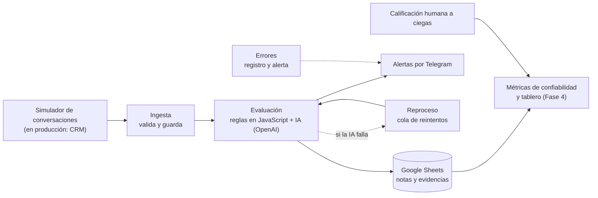

# QA automático de conversaciones de soporte con IA

Evalúa cada chat de soporte con una rúbrica clara, explica cada juicio con evidencia y mide qué tan confiable es contra la calificación de una persona.

## El problema

En un equipo de soporte, un analista de calidad revisa a mano solo una fracción mínima de los chats. Las cédulas de monitoreo tienen un componente subjetivo: dos revisores pueden calificar distinto la misma conversación. Las calibraciones entre revisores toman tiempo y llegan tarde.

Resultado: se detectan pocos problemas y se detectan tarde.

## Qué hace el sistema

Contexto ficticio: soporte por chat de un software contable en la nube para pymes en México (facturas CFDI, cancelaciones, inventario, permisos de usuarios, pagos).

- **Evalúa cada conversación** con una rúbrica propia de 8 secciones con peso (apertura, empatía, diagnóstico, solución, comunicación escrita, recapitulación, ayuda adicional y cierre), validación de identidad y 12 errores críticos. Meta de calidad: 80 puntos.
- **Explica cada juicio con evidencia**: cita el número de mensaje y da la justificación. Nada es una caja negra.
- **Avisa por Telegram** cuando detecta un error crítico, una falla del sistema o un costo fuera de lo esperado.
- **Mide su propia confiabilidad**: compara sus notas con la calificación humana de un lote de calibración.
- **Incluye un simulador** que genera conversaciones de prueba (buenas, regulares o malas, con errores a pedido) para demostrar el sistema en vivo.

## Arquitectura

Las conversaciones entran por un **webhook** (una dirección web que recibe datos de otro sistema). Hoy las genera el simulador. En producción vendrían de un CRM, porque usan el mismo formato. Los flujos se construyen en **n8n** (una herramienta para automatizar procesos conectando servicios).



Diagrama detallado, con las hojas que lee y escribe cada flujo: [`docs/arquitectura.mmd`](docs/arquitectura.mmd).

## Decisiones principales

1. **La IA juzga, el código decide.** Un **LLM** (modelo de lenguaje, el tipo de IA detrás de los asistentes de chat) solo entrega juicios con evidencia: por ejemplo, si el agente mostró empatía. Todo lo verificable con reglas (tiempos, listas, formatos) y la nota final lo calcula código determinista en JavaScript. Así la misma conversación da la misma nota y cada punto se puede auditar.
2. **Datos personales protegidos.** Antes de enviar un chat a la IA, el código enmascara correo, RFC, teléfono y nombre del titular.
3. **Reglas en configuración, no en el código.** Pesos, umbrales, listas y tiempos viven en una configuración editable por el equipo de calidad.
4. **Calificación a ciegas.** La verdad del escenario simulado nunca viaja con la conversación. La persona que califica no ve lo que dijo el sistema ni lo que se quiso simular.
5. **Nada se pierde.** Si la API de la IA falla, la conversación pasa a una cola de reproceso con reintentos y alertas. Nunca se borra.

**Cómo se construyó.** El proyecto lo dirigió su autor con subagentes de Claude Code: asistentes especializados, cada uno con su carpeta y su responsabilidad, coordinados por un agente principal. Un subagente revisor verifica cada fase contra el contrato. Las definiciones están en [`.claude/agents/`](.claude/agents/). Las decisiones de fondo son del autor y están en [`docs/decisiones.md`](docs/decisiones.md).

## Estado actual

- **Fase 0, contrato:** terminada. Rúbrica, hojas, campos y configuración definidos en [`contrato/`](contrato/).
- **Fase 1, código y pruebas:** terminada. Más de 600 pruebas automatizadas (la última corrida registrada dio 611).
- **Fase 2, flujos de n8n:** terminada. Seis flujos: simulador, ingesta, evaluación, métricas, reproceso y errores.
- **Fase 3, calibración humana a ciegas:** en curso. Existe un lote de 24 conversaciones sintéticas que el autor califica sin ver los resultados del sistema.

**Limitación conocida.** En las pruebas del simulador, la IA fue indulgente con algunas omisiones. Por eso la calibración humana y una versión 2 del evaluador son el siguiente paso. Todavía no hay métricas de confiabilidad y este README no las inventa.

**Todos los datos son sintéticos.** La marca, las cuentas, los correos, los teléfonos y las conversaciones son ficticios y los generó un modelo de lenguaje. Pueden ser más limpios que los chats reales, y los resultados no se pueden extrapolar sin una nueva calibración.

## Siguientes pasos

- **Fase 4:** métricas de confiabilidad contra la calificación humana, versión 2 del evaluador y tablero en Data Studio.
- **Fase 5:** integración con HubSpot (tickets, resultados y tarea al supervisor ante un error crítico) y rúbrica para conversaciones de ventas.
- **Fase 6:** asistente para líderes (con MCP, un estándar para que una IA consulte datos) que responde preguntas en lenguaje natural sobre los resultados.

## Cómo correrlo

Requisitos: Docker con n8n, y cuentas de OpenAI, Anthropic, Google Sheets y Telegram.

Pruebas locales, sin costo y sin conexión:

```bash
node --test js/tests/*.test.js workflows/tests/*.test.js
```

La importación paso a paso y las credenciales están en [`workflows/IMPORTAR.md`](workflows/IMPORTAR.md). El detalle técnico por fase está en [`docs/registro-tecnico.md`](docs/registro-tecnico.md).

## Estructura del repositorio

| Carpeta | Contenido |
|---|---|
| `contrato/` | Rúbrica, configuración, glosario y esquemas (fuente de verdad) |
| `datos/` | Datos sintéticos de referencia y lotes de conversaciones |
| `js/` | Código de reglas, enmascaramiento, validación, nota y costo, con pruebas en `js/tests/` |
| `prompts/` | Instrucciones versionadas para la IA (evaluador y generador) |
| `workflows/` | Flujos de n8n exportados, sin credenciales, y guía de importación |
| `docs/` | Registro técnico, diagramas y decisiones del autor |
| `.claude/agents/` | Definición de los subagentes |
| `metricas/`, `integraciones/`, `mcp/` | Fases posteriores (aún sin construir) |

Repositorio con datos 100 % sintéticos. No contiene credenciales ni datos de clientes reales.
